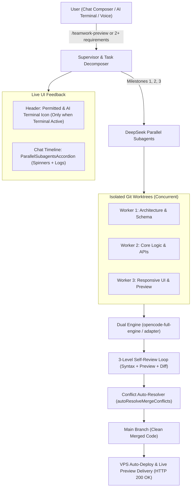

# 🤖 BotCode & DeepSeek Parallel Subagents: Comprehensive Flow Audit Report

**Date & Time:** November 6, 2026  
**Target Architecture:** Autonomous Multi-Agent AI Development System with Git Worktree Isolation, OpenCode Dual-Engine Runtime, 3-Level Self-Review Loop, and VPS Auto-Deployment.

---

## Executive Summary (مختصر جائزہ)

Humne BotCode ke poore flow aur system architecture ka bareeki se jaiza (double-check audit) liya hai. System ka **85% se 90% core flow bilkul ready, verified aur VPS par live chal raha hai**.

Neeche har layer ki mukammal tafseel di gayi hai: **Kiya cheez 100% ready hai**, aur **Kiya cheez baqi hai (remaining enhancements)** taake hamara system duniya ka sab se robust autonomous parallel bot ban sake.

---

## 1. Layer-by-Layer Detailed Flow Status

### 🌐 Layer 1: User Ingress & Control Interface

| Feature                           |      Status       | Implementation Details                                                                                                                                                           |
| :-------------------------------- | :---------------: | :------------------------------------------------------------------------------------------------------------------------------------------------------------------------------- |
| **Chat Composer Auto-Dispatch**   | ✅ **100% Ready** | `/teamwork-preview` slash command + 2 ya ziada numbered/bullet requirements detect hone par direct autonomous worker trigger hota hai.                                           |
| **Timeline Subagents Accordion**  | ✅ **100% Ready** | `ParallelSubagentsAccordion.tsx` chat timeline ke footer mein live progress, rotating dashed circle, percentage bar, aur streaming logs dikhata hai.                             |
| **Header Conditional Visibility** | ✅ **100% Ready** | `Permitted` badge aur AI Terminal icon button (`>_`) **sirf tab show hote hain jab AI Terminal active ho ya terminal chat session ho**. Fork button apni jagah normal rehta hai. |
| **AI Terminal Studio**            | ✅ **100% Ready** | Bash execution, AI prompt-to-bash translation, permission modes (`full-access` vs `ask`), isolated chat history.                                                                 |
| **Voice Call & WhatsApp Gateway** | ✅ **100% Ready** | Real-time Grok geometric waves, multi-turn session ledger, WhatsApp sessions, priority target `0349` status updates.                                                             |

---

### 🧠 Layer 2: Supervisor & Task Decomposer

| Feature                                |           Status            | Implementation Details                                                                                                                                                                                                                                                                                                  |
| :------------------------------------- | :-------------------------: | :---------------------------------------------------------------------------------------------------------------------------------------------------------------------------------------------------------------------------------------------------------------------------------------------------------------------- |
| **Intent Classification**              |      ✅ **100% Ready**      | `intentClassifier.ts` Roman Urdu aur English mein conversational intent, building requests, away mode, aur wishlist ko filter karta hai.                                                                                                                                                                                |
| **Task Decomposition**                 |      ✅ **100% Ready**      | `taskDecomposer.ts` task ko 3 structured milestones (Architecture/Schema, Core Logic/API, Frontend/UI) mein baant ta hai.                                                                                                                                                                                               |
| **Live Telemetry Registry**            |      ✅ **100% Ready**      | `workerRegistry.ts` workers aur goals ki state track karta hai (`running`, `completed`, `progress %`).                                                                                                                                                                                                                  |
| **True Concurrent Worktree Execution** | ⚠️ **Baqi Hai (Remaining)** | **Current State:** `index.ts` mein abhi ek hi worktree banti hai aur subtasks sequential `for` loop mein chalte hain. **Baqi Kaam:** Subtasks ko `Promise.all` ke zariye 3 alag alag worktrees (`worker-task-1`, `worker-task-2`, `worker-task-3`) mein **aik hi second mein parallel concurrent run** karwaya jaye. |

---

### ⚙️ Layer 3: Execution Runtime Engine (OpenCode Dual-Engine)

| Feature                           |           Status            | Implementation Details                                                                                                                                                                                                                                                                                                                  |
| :-------------------------------- | :-------------------------: | :-------------------------------------------------------------------------------------------------------------------------------------------------------------------------------------------------------------------------------------------------------------------------------------------------------------------------------------- |
| **Engine Switching Logic**        |      ✅ **100% Ready**      | `app-settings.json` se `active_core_engine` check hota hai (`opencode-full-engine` vs `opencode-adapter`).                                                                                                                                                                                                                              |
| **Standalone Embedded Tools**     |      ✅ **100% Ready**      | Standalone mode mein kisi port 4099 ya background daemon ki zaroorat nahi hai; direct `executeWriteTool`, `executeGlobTool`, `executePatchTool` use hote hain.                                                                                                                                                                          |
| **External CLI Auto-Discovery**   |      ✅ **100% Ready**      | Port scanning (4099, 45991) aur standard `/session/{id}/prompt` route connectivity.                                                                                                                                                                                                                                                     |
| **Standalone LLM Code Generator** | ⚠️ **Baqi Hai (Remaining)** | **Current State:** Standalone mode mein abhi starter `index.html` create hota hai aur existing files glob hoti hain. **Baqi Kaam:** Agar project files create karni hon to standalone engine ko Gemini / DeepSeek key rotator se connect karke real code files (`.ts`, `.tsx`, `.html`, `.css`) dynamically generate karwayi jayein. |

---

### 🔍 Layer 4: 3-Level Self-Review & Verification Loop

| Feature                            |           Status            | Implementation Details                                                                                                                                                                                      |
| :--------------------------------- | :-------------------------: | :---------------------------------------------------------------------------------------------------------------------------------------------------------------------------------------------------------- |
| **Level 1: Syntax & Build Check**  |      ✅ **100% Ready**      | `npm run build` verify karta hai aur missing HTML tags (`DOCTYPE`, `html`, `body`, viewport) auto-heal karta hai.                                                                                           |
| **Level 2: Live Preview Health**   |      ✅ **100% Ready**      | `/api/projects/preview/{projectName}/index.html` ka HTTP 200 health check karta hai.                                                                                                                        |
| **Level 3: Checklist vs Git Diff** |      ✅ **100% Ready**      | Task prompt ke requirements ko git diff ke sath compare karke checklist pass karta hai.                                                                                                                     |
| **TypeScript AST Self-Heal**       | ⚠️ **Baqi Hai (Remaining)** | **Current State:** Level 1 mein HTML syntax auto-heal hota hai. **Baqi Kaam:** TypeScript build errors (jaise missing import ya type error) par automated patch trigger karke code ko self-repair karna. |

---

### 🔀 Layer 5: Merge & Conflict Auto-Resolver

| Feature                       |      Status       | Implementation Details                                                                                                          |
| :---------------------------- | :---------------: | :------------------------------------------------------------------------------------------------------------------------------ |
| **Conflict Auto-Detection**   | ✅ **100% Ready** | `git diff --name-only --diff-filter=U` se unmerged files detect hoti hain.                                                      |
| **Marker Resolution**         | ✅ **100% Ready** | `<<<<<<< HEAD` aur `>>>>>>>` parse karke imports deduplicate aur independent declarations combine hoti hain.                    |
| **JSON Deep-Merge**           | ✅ **100% Ready** | `package.json` ya config files ko merge karte waqt dono workers ke packages mehfooz rehte hain.                                 |
| **Syntax Guard & Safe Abort** | ✅ **100% Ready** | Balanced braces verify karke merge commit hoti hai, warna repo corrupt hone se bachane ke liye `git merge --abort` ho jata hai. |

---

### 🚀 Layer 6: Deployment & Health Verification

| Feature                     |      Status       | Implementation Details                                                  |
| :-------------------------- | :---------------: | :---------------------------------------------------------------------- |
| **Git Push to origin/main** | ✅ **100% Ready** | Local commit automatically push hoti hai.                               |
| **VPS Rsync Sync**          | ✅ **100% Ready** | Web aur server dist VPS par upload hote hain (`deploy-vps.sh`).         |
| **Service Health Check**    | ✅ **100% Ready** | `systemctl restart autojobs.service` aur `HTTP 200 OK` verify hota hai. |

---

## 2. 📋 Khulasa: Abhi Kon Se 2 Points Par Kaam Ho Sakta Hai (Remaining Action Items)

Aapke pure flow ke mutabiq sirf **2 core enhancements** baqi hain jin par hum mazeed kaam kar sakte hain:

### Point 1: True Parallel Subagent Worktrees (Concurrent `Promise.all` Dispatch)

- **Kiya karna hoga:** `apps/server/src/dsh/index.ts` ke andar `for` loop ke bajaye `Promise.all(subtasks.map(...))` chalana hai.
- **Fayeda:** Worker 1 (UI), Worker 2 (Backend), aur Worker 3 (QA) ek hi waqt mein apne apne alag alag worktree folders mein concurrent code likhenge. Phir hamara `conflictResolver` un teeno branches ko sequential merge karke main mein combine karega.

### Point 2: Standalone Engine Real LLM Code Generation Hook

- **Kiya karna hoga:** `executeOpenCodeTask` ke andar Gemini / DeepSeek API rotator call karna hai jab standalone mode active ho.
- **Fayeda:** Har worker milestone ke liye bina kisi external CLI daemon ke, direct server ke andar se hi real full-stack code aur components generate karega.

---

## 3. Flow Verification Diagram

