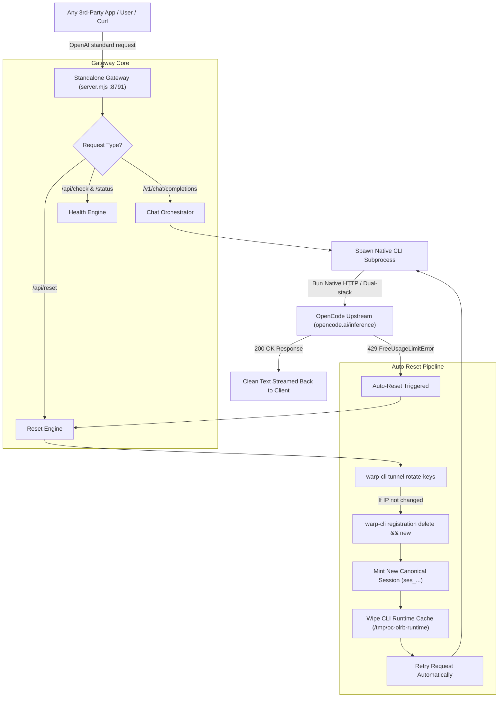

# OpenCode Free Lane Bypass & Auto-Reset Architecture (flow.md)

Yeh document **OpenCode Free Models Inference Gateway** ki mukammal architecture, traffic flow, Cloudflare WARP IP rotation, Privoxy bridge, canonical session minting, aur third-party integration ka tafseeli reference guide hai.

---

## 1. Executive Summary (خلاصہ)

Yeh system OpenCode ke free lane models (`hy4-flash-free`, `beam-free`, `glm-5.3-flash-free`, `minimax-m3.1-flash-free` wagera) ko **bina kisi paid subscription ya heavy 200MB background daemon** ke 100% free aur stable chalaane ke liye design kiya gaya hai. 

Jab bhi upstream free tier ka 429 quota limit hit hota hai, system **2.5 se 3 seconds ke andar** naya Cloudflare IP subnet rotate karta hai aur naya session mint karke request ko seamlessly continue karta hai.

---

## 2. Core Components & Their Roles (اہم اجزاء اور ان کے کام)

| Component | Port / Location | Asal Kaam (Role) |
|---|---|---|
| **Cloudflare WARP** | SOCKS5 `127.0.0.1:40000` | Cloudflare ke Anycast network se residential/clean exit IP provide karta hai aur IP rotation handle karta hai. |
| **Privoxy** | HTTP `127.0.0.1:8118` | HTTP Proxy ko SOCKS5 (`127.0.0.1:40000`) mein bridge/convert karta hai taake standard HTTP tools WARP use kar sakein. |
| **Native OpenCode CLI** | `/root/.opencode/bin/opencode` | Lightweight Bun-based native binary jo OpenCode upstream ke exact headers, TLS fingerprint, aur request structure ko handle karti hai. |
| **Session Minting** | In-Memory / Node runtime | Canonical format (`ses_<hex_timestamp><base62_random>`) mein session IDs generate karta hai taake upstream session affinity bypass rahe. |
| **Standalone Gateway** | Port `8791` (`server.mjs`) | OpenAI-compatible REST API (`/v1/chat/completions`), live diagnostics (`/api/check`), aur auto-reset orchestrator. |

---

## 3. End-to-End Traffic Architecture (مکمل فلو ڈایاگرام)



---

## 4. Key Sub-systems Explained (اہم سسٹمز کی تفصیل)

### A. Cloudflare WARP ka Kaam
- Upstream server (`opencode.ai`) direct datacenter IPs ko jaldi block ya rate-limit karta hai.
- Cloudflare WARP aapke server ki outgoing requests ko Cloudflare Anycast edge IPs ke zariye route karta hai.
- Jab limit hit hoti hai to `warp-rotate.sh` script:
  1. Pehle `warp-cli tunnel rotate-keys` aur reconnect karta hai.
  2. Agar IP change na ho to fallback ke tor par `warp-cli registration delete` karke foran `warp-cli registration new` chalaata hai, jisse **100% naya IP subnet** mil jata hai.

### B. Privoxy Proxy ka Kaam
- Cloudflare WARP by default sirf **SOCKS5** protocol (`127.0.0.1:40000`) par chalta hai.
- Bohat saare HTTP clients aur environment variables (`HTTP_PROXY`, cURL) direct SOCKS5 support nahi karte ya unstable hote hain.
- **Privoxy** port `8118` par listen karta hai aur har incoming HTTP request ko foran `forward-socks5 / 127.0.0.1:40000 .` ke through WARP ko forward kar deta hai.

### C. Canonical Session Minting ka Kaam
- OpenCode upstream server har request par session track karta hai. Agar ek hi session par bar bar requests aayein to rate limit lag jati hai.
- Hamara system exact canonical structure mint karta hai:
  ```javascript
  function mintSession() {
    const ts = Date.now().toString(16);
    let rand = "";
    const bytes = crypto.randomBytes(16);
    for (let i = 0; i < bytes.length; i++) {
      rand += BASE62[bytes[i] % BASE62.length];
    }
    return `ses_${ts}${rand}`;
  }
  ```
- Yeh format OpenCode ke internal canonical IDs (`ses_...`) se 100% match karta hai.

### D. Native CLI Subprocess Execution
- Pehle `server.mjs` direct cURL ya Node fetch use kar raha tha jahan TLS fingerprint aur header parsing par upstream 429 block de raha tha.
- Ab `server.mjs` background mein native `opencode run` CLI ko subprocess ke tor par call karta hai.
- **Fayda:** Native CLI Bun runtime par chalti hai aur iska HTTP client upstream ke sath 100% compatible hai, jiski wajah se 429 bypass ho jata hai.

---

## 5. Resource Consumption (وسائل کی کھپت)

Yeh setup resource ke lihaz se nihayat lightweight hai:

- **RAM:**
  - `server.mjs` (Node.js): ~16 MB to 25 MB
  - `warp-svc` (Cloudflare WARP): ~35 MB to 45 MB
  - `privoxy`: ~3 MB
  - CLI Subprocess (sirf request ke waqt 2-3 sec ke liye): ~30 MB
  - **Total Active RAM Footprint:** **~50 MB se 100 MB** (Bina kisi background daemon ke).
- **Disk Space:**
  - Total binary + scripts + node environment: **~150 MB se 200 MB**.
- **CPU:**
  - Idle state: **0% - 0.2%**
  - Active generation: **1% - 3%**

---

## 6. Third-Party Application Integration Guide (دیگر ایپس کے ساتھ جوڑنا)

Yeh setup standard OpenAI format expose karta hai, isliye aap ise kisi bhi framework (LangChain, LlamaIndex, Cursor, Continue, AutoGen, Next.js, Python, wagera) ke sath direct connect kar sakte hain.

### A. Connection Details
- **Base URL:** `https://oc.tokendeal.cloud/v1` (ya local VPS par `http://127.0.0.1:8791/v1`)
- **API Key:** `public` (kisi bhi string ko accept karta hai)
- **Available Models:**
  - `hy4-flash-free` (Fast & High Context)
  - `beam-free` (Coding & Logic)
  - `glm-5.3-flash-free`
  - `minimax-m3.1-flash-free`

---

### B. Code Examples

#### 1. cURL (Direct Terminal)
```bash
curl -X POST https://oc.tokendeal.cloud/v1/chat/completions \
  -H "Content-Type: application/json" \
  -H "Authorization: Bearer public" \
  -d '{
    "model": "hy4-flash-free",
    "messages": [
      {"role": "user", "content": "Hello, write a quick python script."}
    ],
    "stream": false
  }'
```

#### 2. Python (Official OpenAI SDK)
```python
from openai import OpenAI

client = OpenAI(
    base_url="https://oc.tokendeal.cloud/v1",
    api_key="public"
)

response = client.chat.completions.create(
    model="hy4-flash-free",
    messages=[
        {"role": "system", "content": "You are a helpful coding assistant."},
        {"role": "user", "content": "Explain how binary search works in 2 lines."}
    ]
)

print(response.choices[0].message.content)
```

#### 3. Node.js / TypeScript (Official OpenAI SDK)
```typescript
import OpenAI from "openai";

const openai = new OpenAI({
  baseURL: "https://oc.tokendeal.cloud/v1",
  apiKey: "public",
});

async function main() {
  const completion = await openai.chat.completions.create({
    model: "hy4-flash-free",
    messages: [{ role: "user", content: "What is 10 + 25?" }],
  });

  console.log(completion.choices[0].message.content);
}

main();
```

---

## 7. Management & Health API Endpoints

Aap apni third-party monitoring ya admin panel se in endpoints ko call kar sakte hain:

1. **System Health Check:**
   - `GET https://oc.tokendeal.cloud/api/check`
   - Returns: 13 checks (Nginx, WARP, Privoxy, IP, upstream status).
2. **System Status & Live IP:**
   - `GET https://oc.tokendeal.cloud/api/status`
   - Returns: Active session, current IP, limit state (`ok` ya `full`), last reset timing.
3. **Manual Instant IP & Limit Reset:**
   - `POST https://oc.tokendeal.cloud/api/reset`
   - Returns: `{ "ok": true, "ipChanged": true, "oldIp": "...", "newIp": "...", "durationMs": 2500 }`
4. **List Available Models:**
   - `GET https://oc.tokendeal.cloud/v1/models`
   - Returns: Standard OpenAI models list.

---

## 8. Testing Lab vs Production Integration (پروڈکشن کے لیے ہدایات)

> [!WARNING]
> **Production Integration Warning:**
> Yeh Web UI Dashboard (`public/index.html`, `styles.css`, `app.js`), Split Log Drawer, aur in-memory `/api/logs` array **sirf testing aur inspection ke liye banaye gaye hain**.
> 
> Jab is setup ko kisi production app (AutoJobs, CLI tool, Cursor, Continue, etc.) ke sath jodein:
> - **UI aur Log Drawer ko shamil na karein** taake RAM aur Disk space zaya na ho.
> - **Sirf Core Engine use karein:**
>   - `POST /v1/chat/completions` (OpenAI format inference)
>   - `scripts/warp-rotate.sh` (429 par IP subnet rotate karna)
>   - Canonical session generator (`ses_...`)
> - Is tarah production par memory footprint sirf **~15MB se 25MB** rahega aur performance maximum rahegi.
